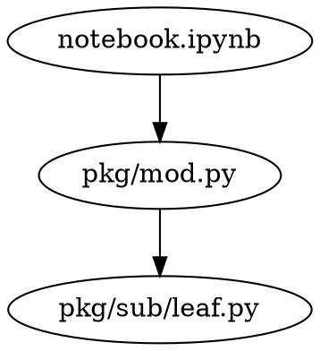

# python-dep-checker 機能拡張計画

最終更新: 2026-11-23  
対象バージョン: 0.1.0.0

## 1. 現状

現在の実装で、次のコアフローは動作している。

1. `.ipynb` の code セルを読む
2. string / comment を除去して `import` / `from ... import ...` を抽出する
3. `--root` 配下のローカル `.py` に解決する
4. 見つかった `.py` を再帰的に解析する
5. 相対パスまたは絶対パスでソートして出力する

一方で、Python 構文の取りこぼし、import 解決の精度、CLI の操作性、テスト・運用面に不足がある。  
以下は README に明記済みの意図的な制限（`%run`、`importlib`、`sys.path` など）を除いた拡張計画である。

## 2. 優先度サマリ

| # | 項目 | 種別 | 優先度 | 主な変更対象 |
| --- | --- | --- | --- | --- |
| 1 | セミコロン区切り・1 行スイートの import | 抽出の取りこぼし | 高 | `ParseImportLine`, 新規 `SplitStatements` |
| 2 | notebook のセルマジック誤検出 | 抽出の取りこぼし | 高 | `ReadNotebookSources`, 新規 `IsNonPythonCell` |
| 3 | CRLF / BOM / エンコーディング | 抽出の取りこぼし | 高 | 新規 `ReadPythonFile`, `ReadNotebookSources` |
| 4 | nbformat v3 | 抽出の取りこぼし | 中 | `ReadNotebookSources` |
| 5 | 未解決 import の報告 | 診断 | 高 | `CollectDependencies`, `Run`, `ParseArgs` |
| 6 | `--json` 出力 | 出力 | 中 | `Run`, 新規 `ToJson` |
| 7 | `--verbose` / `--fail-on-missing` | 診断 | 中 | `Run`, `Options` |
| 8 | パスの正規化・重複排除 | 解決精度 | 中 | `CollectDependencies`, `ResolveImport` |
| 9 | パッケージとモジュールの優先順位 | 解決精度 | 中 | `ResolveImport` |
| 10 | 相対 import の `__init__.py` | 解決精度 | 中 | `ResolveImport` |
| 11 | 複数 notebook / ディレクトリ入力 | CLI | 中 | `ParseArgs`, `Options`, `Run` |
| 12 | `--version` / `--relative-to` / `--` | CLI | 中 | `ParseArgs`, `PrintUsage` |
| 13 | 名前空間パッケージ / `.pyi` | 解決精度 | 低 | `ResolveImport` |
| 14 | ルート自動検出 | 解決精度 | 低 | 新規 `DetectRoots`, `ParseArgs` |
| 15 | `--exclude` / `--graph` / 設定ファイル | CLI | 低 | `ParseArgs`, `Run` |
| 16 | テスト追加・CI・README 更新 | 品質 | 高 | `test/`, `.github/`, `README.md` |

## 3. Phase 1: import 抽出の取りこぼし修正

### 1.1 セミコロン区切りと 1 行スイート

**現状**

- `import a; import b` は `a;` が不正なモジュール名になり、両方失われる。
- `from pkg import a; import b` は `import` を import 名として拾い、誤検出になる。
- `if cond: import x`、`try: import x`、`def f(): import x` のようなコロン以降の import が読まれない。

**方針**

- 新規 `src/PythonDepChecker/SplitStatements.hs` を追加し、`splitStatements :: Text -> [Text]` を実装する。
- string / comment 除去後の論理行を、トップレベルの `;` で分割する。括弧 `()[]{}` の深さを追跡し、括弧内の `;` では分割しない。
- 行頭が compound statement（`if`, `elif`, `else`, `while`, `for`, `try`, `except`, `finally`, `with`, `def`, `class`, `match`, `case`, `async for`, `async with`, `async def`）の場合は、トップレベルの `:` を探し、その後ろを simple statement 列として同じ分割処理にかける。
- `elif` / `else` / `except` / `finally` / `case` は行頭キーワードとして扱う。
- 分割後の各断片を `T.strip` し、空要素は捨てる。
- `ExtractImports` のパイプラインに組み込む。

```
stripPythonStrings
  -> stripPythonComments
  -> logicalLines
  -> SplitStatements.splitStatements
  -> ParseImportLine.parseImportLine
```

**変更ファイル**

- 新規: `src/PythonDepChecker/SplitStatements.hs`
- 変更: `src/PythonDepChecker/ExtractImports.hs`
- 変更: `python-dep-checker.cabal` の `exposed-modules`
- 新規: `test/Test/PythonDepChecker/SplitStatementsSpec.hs`
- 変更: `test/Spec.hs`（hspec-discover なら自動）
- 変更: `python-dep-checker.cabal` の test `other-modules`

**受け入れ条件**

- `import a; import b` から `a` と `b` の 2 件が得られる。
- `from pkg import a; import b` から `ImportRef 0 ["pkg"] ["a"]` と `ImportRef 0 ["b"] []` が得られる。
- `if TYPE_CHECKING: import pkg.mod` から `pkg.mod` が得られる。
- `x = {1: 2}; import os` から `os` が得られる。
- `from pkg import (\n  a,\n  b,\n)` の既存動作が壊れない。

### 1.2 notebook のセルマジック

**現状**

- `%%writefile utils.py` や `%%bash` のセル本文も通常の Python として解析するため、実行されない import を誤検出する。

**方針**

- 新規 `src/PythonDepChecker/IsNonPythonCell.hs` を追加し、`isNonPythonCell :: Text -> Bool` を実装する。
- セル先頭の空行を読み飛ばし、最初の非空行が `%%` で始まる場合にマジック名を取り出す。
- 次のマジックは「notebook カーネルで Python として実行されない」ものとしてセル全体を除外する。
  - `writefile`, `file`
  - `bash`, `sh`, `script`
  - `html`, `javascript`, `js`, `latex`, `markdown`, `svg`
  - `perl`, `ruby`, `sql`, `R`
- `%%capture`, `%%time`, `%%timeit`, `%%prun`, `%%debug`, `%%python` など、Python コードを実行するものは除外しない。
- 未知のマジックは安全側に倒して除外しない（依存を取りこぼさないため）。

**変更ファイル**

- 新規: `src/PythonDepChecker/IsNonPythonCell.hs`
- 変更: `src/PythonDepChecker/ReadNotebookSources.hs`
- 変更: `python-dep-checker.cabal`
- 変更: `test/Test/PythonDepChecker/ReadNotebookSourcesSpec.hs`

**受け入れ条件**

- `%%writefile sample.py\nimport os\n` のセルは依存に含まれない。
- `%%bash\nimport os\n` のセルは依存に含まれない。
- `%%capture\nimport pkg.mod\n` のセルは依存に含まれる。
- マジックでない通常セルの動作が変わらない。

### 1.3 CRLF / BOM / エンコーディング

**現状**

- Python ファイルを `Data.Text.IO.readFile` で読むため、ロケール依存で失敗し得る。
- BOM 付きファイルは先頭の import が不正なトークンになる。
- CRLF ファイルでは行末の `\r` によりバックスラッシュ継続が壊れる。

**方針**

- 新規 `src/PythonDepChecker/ReadPythonFile.hs` を追加し、`readPythonFile :: FilePath -> IO (Either String Text)` を実装する。
- `ByteString` で読み、UTF-8 BOM (`EF BB BF`) を除去する。
- `Data.Text.Encoding.decodeUtf8With lenientDecode` でデコードする。
- `\r\n` と単独の `\r` を `\n` に正規化する。
- `CollectDependencies` の `readPythonFile` ローカル実装を新モジュールに置き換える。
- `.ipynb` も UTF-8 BOM 付きを受け付けるよう、`ReadNotebookSources` でデコード前に BOM を除去する。
- 非 UTF-8 の coding cookie（`# -*- coding: cp932 -*-` など）は今回のスコープ外とし、README に制限として追記する。

**変更ファイル**

- 新規: `src/PythonDepChecker/ReadPythonFile.hs`
- 変更: `src/PythonDepChecker/CollectDependencies.hs`
- 変更: `src/PythonDepChecker/ReadNotebookSources.hs`
- 変更: `python-dep-checker.cabal`
- 新規: `test/Test/PythonDepChecker/ReadPythonFileSpec.hs`
- 変更: `test/Test/PythonDepChecker/CollectDependenciesSpec.hs`

**受け入れ条件**

- CRLF の `from pkg import \\\n    a` が `a` まで解決される。
- BOM 付き Python ファイルの先頭 import が解決される。
- BOM 付き notebook が JSON デコードに成功する。
- 不正な UTF-8 バイト列でも例外で落ちず、置換文字として読み進める。

### 1.4 nbformat v3

**現状**

- トップレベル `cells` のみを見るため、古い `worksheets[].cells` 形式では空結果になる。

**方針**

- `ReadNotebookSources` に v3 フォールバックを追加する。
- トップレベル `cells` が配列ならそれを使う。
- なければ `worksheets` 配列を走査し、各要素の `cells` 配列を連結する。
- どちらもなければ空リストを返す（現状互換）。

**変更ファイル**

- 変更: `src/PythonDepChecker/ReadNotebookSources.hs`
- 変更: `test/Test/PythonDepChecker/ReadNotebookSourcesSpec.hs`

**受け入れ条件**

- v3 形式の notebook から code セルの import が読める。
- v4 形式の既存テストが通る。

### 1.5 `from pkg import *` の扱い

**現状**

- `*` が `validName` で捨てられ、`pkg/__init__.py` だけが解決される。

**方針**

- `ParseImportLine.parseFrom` で `*` を特別に保持する。
- 基本動作は `pkg/__init__.py` を依存に含め、そのファイル内の import を推移的にたどることで、公開名・再エクスポートされたサブモジュールを拾う。
- ディレクトリ内の全 `.py` を機械的に列挙する近似はデフォルトでは行わない（過剰検出になるため）。
- 将来オプションとして `--expand-star` を追加する場合は、パッケージ直下の公開モジュールを列挙する旨を README に明記する。

**変更ファイル**

- 変更: `src/PythonDepChecker/ParseImportLine.hs`
- 変更: `test/Test/PythonDepChecker/ExtractImportsSpec.hs`
- 変更: `test/Test/PythonDepChecker/ResolveImportSpec.hs`

**受け入れ条件**

- `from pkg import *` が `pkg/__init__.py` を依存に含む。
- `pkg/__init__.py` が `from . import mod` している場合、`pkg/mod.py` も推移的に含まれる。

## 4. Phase 2: 診断と出力

### 2.1 未解決 import の収集

**現状**

- 解決できなかった import は黙って捨てられる。

**方針**

- 新規 `src/PythonDepChecker/CollectResult.hs` に結果型を追加する。

```haskell
data CollectResult = CollectResult
  { collectedFiles :: [FilePath]
  , unresolvedImports :: [(FilePath, ImportRef)]
  }
```

- `collectDependencies` の戻り値を `IO (Either String CollectResult)` に変更する。
- `resolveRefs` で `ImportRef` ごとの解決結果を保持し、結果が空のものを `unresolvedImports` に記録する。
- importer は notebook または解析対象の `.py` パスとする。
- 既存の「ファイル一覧だけ使う」呼び出しは `collectedFiles` を参照するよう更新する。

**変更ファイル**

- 新規: `src/PythonDepChecker/CollectResult.hs`
- 変更: `src/PythonDepChecker/CollectDependencies.hs`
- 変更: `src/PythonDepChecker/Run.hs`
- 変更: `test/Test/PythonDepChecker/CollectDependenciesSpec.hs`

**受け入れ条件**

- `import os` のようなローカルに存在しない import が `unresolvedImports` に入る。
- 完全に解決できた import は入らない。
- 既存の依存ファイル一覧の結果が変わらない。

### 2.2 `--report-missing`

- `Options` に `optionsReportMissing :: Bool` を追加する。
- 有効時、`unresolvedImports` を stderr に次の形式で出力する。

```
warning: <importer>: unresolved import <module> (names: a, b)
```

- 相対 import は先頭のドットをレベル数だけ表示する（例: `..pkg.mod`）。
- 標準ライブラリ・サードパーティとの区別は今回のスコープ外とし、「探索ルート配下で見つからなかった」と README に明記する。

### 2.3 `--json`

- `Options` に `optionsJson :: Bool` を追加する。
- 新規 `src/PythonDepChecker/ToJson.hs` を追加し、次のスキーマで stdout に 1 つの JSON オブジェクトを出力する。

```json
{
  "notebooks": ["path/to/notebook.ipynb"],
  "files": ["pkg/mod.py", "pkg/__init__.py"],
  "unresolved": [
    {
      "importer": "pkg/mod.py",
      "level": 0,
      "module": ["pkg", "missing"],
      "names": []
    }
  ]
}
```

- パスは `--absolute` / `--relative-to` の設定に従う。
- `--json` と通常出力は排他的に扱う。
- aeson は既存依存なので追加依存なし。

### 2.4 `--verbose` / `--quiet` / `--fail-on-missing`

- `Options` に以下を追加する。
  - `optionsVerbose :: Bool`
  - `optionsQuiet :: Bool`
  - `optionsFailOnMissing :: Bool`
- `--verbose` では次を stderr に出す。
  - 存在しない `--root`
  - 読み込めなかった Python ファイル（権限エラーなど）
  - 解決に失敗した import の詳細
- `--quiet` は進捗・警告を抑制するが、致命的エラーは出す。
- `--fail-on-missing` は `unresolvedImports` が空でない場合に終了コード 1 を返す。
- 終了コードの仕様を README に追記する。
  - 0: 正常
  - 1: 引数エラー、notebook 読み込みエラー、または `--fail-on-missing` による未解決あり

### 2.5 `--version`

- `Paths_python_dep_checker` の `version` を使い、`python-dep-checker 0.1.0.0` を表示する。
- cabal の `autogen-modules` 設定を確認し、executable から import できるようにする。
- 新規 `src/PythonDepChecker/PrintVersion.hs` を追加する。

## 5. Phase 3: import 解決の精度

### 3.1 パスの正規化・重複排除

**現状**

- `normalise` のみで、シンボリックリンクや絶対/相対ルートの混在により同じファイルが重複し得る。

**方針**

- 依存ファイルを `Map FilePath FilePath`（キー: `canonicalizePath` の結果、値: 表示用の元パス）で管理する。
- 同一実体のファイルは 1 回だけ出力する。
- 表示パスは最初に見つかったものを優先する。
- `canonicalizePath` は `System.Directory` にあり、追加依存なし。

**変更ファイル**

- 変更: `src/PythonDepChecker/CollectDependencies.hs`
- 変更: `src/PythonDepChecker/ToDisplayPath.hs`（必要なら）
- 追加テスト: シンボリックリンク経由の重複

### 3.2 パッケージとモジュールの優先順位

**現状**

- `pkg/mod.py` と `pkg/mod/__init__.py` が両方ある場合、両方を列挙する。
- Python はパッケージ（`__init__.py`）を優先する。

**方針**

- `moduleTerminals` をパッケージ優先に変更する。
- パッケージが存在する場合は `.py` を候補から外す。
- ただし、明示的に `pkg/mod.py` を指す import が別途ある場合はその解決結果を尊重する。
- 既存テストへの影響を確認し、必要なら「過剰検出を許容する」オプションは設けず Python 準拠に寄せる。

### 3.3 相対 import の `__init__.py`

**現状**

- `from . import sibling` は `sibling.py` のみを返し、カレントパッケージの `__init__.py` を依存に含めない。

**方針**

- 相対 import の基準ディレクトリに対応する `__init__.py` が存在すれば候補に加える。
- level 1 は importer のディレクトリ、level 2 以上は `relativeBase` のディレクトリ。
- 既存のテストに `pkg/__init__.py` が含まれることを追加する。

### 3.4 名前空間パッケージ（PEP 420）

**現状**

- `import ns` は `ns/__init__.py` がないと解決できない。
- `import ns.mod` や `from ns import mod` はサブモジュールが実在すれば解決できる。

**方針**

- `import ns` のようにパッケージ自身を指す import で、`ns/` ディレクトリが存在する場合は名前空間パッケージとして扱う。
- 名前空間パッケージ自体にはファイルが存在しないため、出力する依存ファイルはない。配下のサブモジュール import に任せる。
- 必要なら `--include-namespace-markers` のようなオプションは設けない。

### 3.5 `.pyi` スタブ

**方針**

- 候補に `name.pyi`、`name/__init__.pyi` を追加する。
- 出力は `.py` と同様に扱うが、README の「ローカル `.py`」という表現を「ローカルの Python ソース（`.py` / `.pyi`）」に更新する。
- 追加するかは需要を見て判断する（低優先）。

## 6. Phase 4: CLI の拡張

### 4.1 複数 notebook / ディレクトリ入力

- `Options` を `optionsNotebooks :: [FilePath]` に変更する。
- `parseArgs` は notebook が 0 個のときだけエラーにする。
- 複数指定時は依存ファイルの和集合を出力する。
- notebook 引数がディレクトリの場合は、配下の `*.ipynb` を再帰探索する。`.ipynb_checkpoints` は除外する。
- JSON 出力では `notebooks` に指定された全 notebook を入れる。
- `--report-missing` の importer は notebook パスになる。

### 4.2 `--relative-to DIR`

- `Options` に `optionsRelativeTo :: Maybe FilePath` を追加する。
- 指定時は CWD ではなく `DIR` からの相対パスを出力する。
- `--absolute` とは排他的にし、同時指定は引数エラーにする。
- `ToDisplayPath` のシグネチャを `toDisplayPath :: Maybe FilePath -> Bool -> FilePath -> IO FilePath` に変更する。

### 4.3 `--` セパレータ

- `parseArgs` で `--` 以降をオプションとして解釈しない。
- `--` 以降の最初の引数を notebook として扱う。
- `--root` の値がない場合のエラーメッセージを「unknown option」ではなく「--root requires a directory」に改善する。

### 4.4 `--exclude`

- `Options` に `optionsExclude :: [String]` を追加する。
- 依存ファイルのパスに対して簡易 glob（`*`, `?`, `**`）で除外する。
- glob 実装のために `Glob` パッケージを追加するか、自前の限定的なマッチャを実装する。
- 追加依存を避ける場合は、まず `--exclude-prefix DIR` と `--exclude-name FILENAME` のような単純なオプションにする。

### 4.5 `--graph`

- 依存関係の辺（importer -> imported）を保持する必要があるため、`CollectResult` に `dependencies :: [(FilePath, FilePath)]` を追加する。
- `--graph` 指定時は DOT 形式で stdout に出力する。



- Graphviz 本体には依存しない（DOT テキストのみ）。

### 4.6 設定ファイル

- `pyproject.toml` の `[tool.python-dep-checker]` を読む案。
- ただし TOML パーサの追加依存が必要になるため、優先度は低い。
- 代替として `.python-dep-checker.json` を aeson で読む。

## 7. Phase 5: テスト・CI・ドキュメント

### 7.1 追加するテスト

- `test/Test/PythonDepChecker/SplitStatementsSpec.hs`
- `test/Test/PythonDepChecker/IsNonPythonCellSpec.hs`
- `test/Test/PythonDepChecker/ReadPythonFileSpec.hs`
- `test/Test/PythonDepChecker/ParseArgsSpec.hs`
- `test/Test/PythonDepChecker/JoinContinuationsSpec.hs`
- `test/Test/PythonDepChecker/StripPythonStringsSpec.hs`
- `test/Test/PythonDepChecker/StripPythonCommentsSpec.hs`
- `test/Test/PythonDepChecker/ToDisplayPathSpec.hs`
- 既存 Spec への追加
  - セミコロン、1 行スイート
  - cell magic
  - CRLF / BOM
  - nbformat v3
  - 相対 import の `__init__.py`
  - パッケージ優先
  - シンボリックリンク重複
  - 未解決 import の収集
  - 複数 notebook
  - `--json` のスキーマ

### 7.2 CI

- `.github/workflows/ci.yml` を追加する。
- `nix develop --command bash -lc 'cabal build all && cabal test && make lint'` を実行する。
- 可能なら `ormolu --mode check` も追加する。
- キャッシュは `~/.cabal` と `dist-newstyle` を対象にする。

### 7.3 README 更新

- `できること` に追加した機能を反映する。
- `オプション` に新しいフラグを追加する。
- `制限` を更新する。
  - 非 UTF-8 の coding cookie は未対応
  - 動的 import は引き続き未対応
  - 名前空間パッケージ自体はファイルとして出力しない
  - `--report-missing` は標準ライブラリとサードパーティを区別しない
- `構成` に新しいモジュールを追加する。
- `--help` の言語（英語）と README（日本語）の不一致を解消する。CLI は英語のままにする場合は README にその旨を書く。

### 7.4 CHANGELOG

- `CHANGELOG.md` を追加し、`0.1.0.0` 以降の変更を記録する。

## 8. 実装順（推奨）

1. **Phase 1.1 / 1.2 / 1.3**: セミコロン・1 行スイート、cell magic、CRLF/BOM。小さく効果が大きく、既存の誤検出・取りこぼしを直接減らせる。
2. **Phase 2.1 / 2.2 / 2.4**: 未解決 import の収集、`--report-missing`、`--verbose` / `--fail-on-missing`。ツールとしての診断性が上がる。
3. **Phase 2.3**: `--json`。他ツールとの連携が可能になる。
4. **Phase 3.1 / 3.2 / 3.3**: パス正規化、パッケージ優先、相対 import の `__init__.py`。解決精度の改善。
5. **Phase 4.1 / 4.2 / 4.3**: 複数 notebook、`--relative-to`、`--`。CLI の実用性向上。
6. **Phase 1.4 / 1.5 / 3.4 / 3.5**: nbformat v3、star import、名前空間パッケージ、`.pyi`。
7. **Phase 4.4 / 4.5 / 4.6**: `--exclude`、`--graph`、設定ファイル。
8. **Phase 5**: テスト・CI・README・CHANGELOG を各 Phase と並行して更新する。

## 9. 実装時の制約

- `structure-lint.json` により、以下を守る。
  - 1 ファイル 1 トップレベル関数
  - 1 ファイル 1 型定義
  - ファイル名と宣言名の一致
  - モジュール名とパスの一致
  - test 配下のファイル名は `Spec` で終わる
  - 1 ファイル 200 行まで
- 新規モジュールは `python-dep-checker.cabal` の `exposed-modules` または test の `other-modules` に追加する。
- 既存 CLI の後方互換を維持する。破壊的変更（`Options` のフィールド変更など）は README と CHANGELOG に記載する。
- 追加依存は最小限にする。aeson / bytestring / text / containers / directory / filepath は既に利用可能。
- 各 Phase の完了時に `cabal build all`、`cabal test`、`make lint`、`make format` を通す。

## 10. 決定が必要な事項

- `--json` のスキーマを上記で固定してよいか。
- 複数 notebook 指定時の出力を「和集合」にするか、「notebook ごとにセクション分け」にするか。
- `--report-missing` で標準ライブラリ・サードパーティを分類するか（分類する場合は Python の標準ライブラリ一覧をどう保持するか）。
- `from pkg import *` を `__init__.py` 経由の推移に限定するか、ディレクトリ列挙の近似オプションを用意するか。
- 非 UTF-8 の coding cookie に対応するか（対応する場合はデコーダの追加依存が必要）。
- `--help` を日本語化するか、英語のまま README を合わせるか。
- `--exclude` の glob 実装に追加依存（`Glob`）を許容するか。
- `.pyi` を依存ファイルとして出力対象に含めるか。
